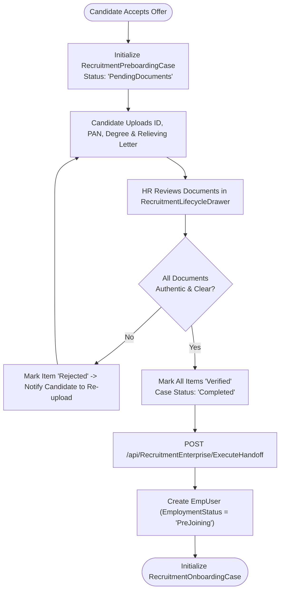
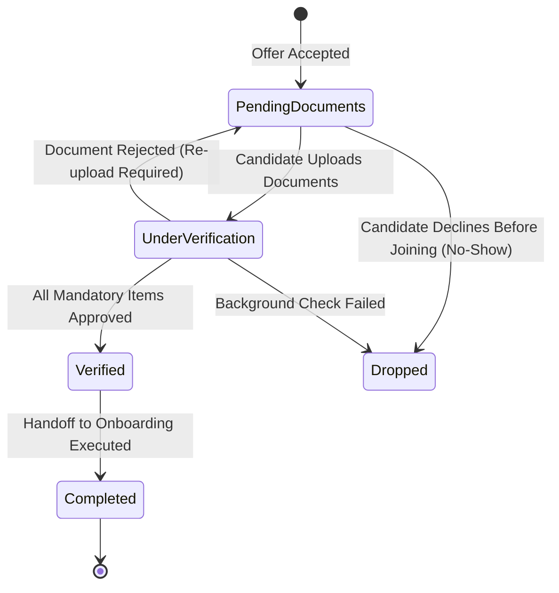

# Module Documentation — Candidate Preboarding (`PREBOARDING`)

> **Document Status**: Complete & Authoritative  
> **Source-of-Truth**: Verified from Repository Implementation  
> **Primary Entities**: `RecruitmentPreboardingCase.cs`, `RecruitmentHandoff.cs`  
> **Primary Services**: `RecruitmentHandoffService.cs`, `RecruitmentApplicationService.cs`  
> **Primary UI**: `RecruitmentPreboardingQueueCard.tsx`, `RecruitmentLifecycleDrawer.tsx`  
> **Last Verified**: September 2026

---

## 1. Module Overview

- **What the module is**: The pre-joining verification bridge situated between candidate offer acceptance and Day-1 employee onboarding. It manages pre-hire document collection, background verification (BGV) tracking, and joining readiness confirmation.
- **Why HR organizations need it**: After a candidate accepts an offer, they typically serve a notice period at their previous employer (30–90 days). During this window, HR must collect identity documents, academic transcripts, and prior relieving letters to verify candidate credentials before provisioning an employee account.
- **What business problem it solves**: Prevents Day-1 onboarding chaos by ensuring all statutory, educational, and identity verifications are completed prior to the candidate's joining date.
- **Who uses it**: **HR Managers**, **HR Executives**, **Recruiters**, and **Selected Candidates**.
- **Where it fits in the HR lifecycle**: Stage 2 (Post-Offer / Pre-Joining)—receives accepted candidates from `Recruitment` and hands verified candidates off to `Onboarding`.

---

## 2. Real-World Business Scenario

```text
Candidate: Siddharth Nair
Accepted Role: Senior Distributed Systems Engineer
Expected Joining Date: November 1, 2026
HR Executive: Pooja Sharma
```
1. Upon Siddharth's offer acceptance on `/candidate/offer`, the system initializes a `RecruitmentPreboardingCase` in `PendingDocuments` status.
2. Pooja views Siddharth in the `RecruitmentPreboardingQueueCard` on the applications dashboard.
3. Siddharth submits scanned copies of his Aadhaar Card, PAN Card, University Degree Certificate, and previous employer resignation acceptance.
4. Pooja reviews each document inside `RecruitmentLifecycleDrawer.tsx` and marks them `Verified`.
5. Once all mandatory preboarding items are verified, Pooja transitions the preboarding case to `Completed`, which automatically triggers `RecruitmentHandoffService` to initialize Siddharth's Day-1 `RecruitmentOnboardingCase` and provision his `EmpUser` record in `PreJoining` status.

---

## 3. Supported Actors

| Actor | Capabilities in Module | Server Enforcement |
|---|---|---|
| **HR Manager / Recruiter**| Reviews preboarding queues, verifies uploaded documents, flags missing items, initiates onboarding handoff. | Enforced via `[ModulePermission(Applications, Edit/Review)]`. |
| **Candidate** | Uploads requested pre-joining documents via candidate portal link. | Scoped to capability token for own application. |
| **Company Administrator** | Full administrative oversight and status override capabilities. | Admin bypass in `RoleServices`. |

---

## 4. Frontend Implementation

| File | Responsibility | Calls | Used By |
|---|---|---|---|
| `src/app/modules/recruitment/applications/components/RecruitmentPreboardingQueueCard.tsx` | Dashboard summary card displaying candidates currently in preboarding, document completion percentages, and blockers. | `recruitmentServices.ts` | `Applications.tsx` |
| `src/app/modules/recruitment/applications/components/RecruitmentLifecycleDrawer.tsx` | Detailed preboarding checklist panel allowing HR to inspect and approve individual document items. | `recruitmentServices.ts` | `Applications.tsx` |

---

## 5. Backend Implementation

| Backend File | Responsibility | Dependencies |
|---|---|---|
| `Codeji.CMS.API/Controllers/RecruitmentEnterpriseController.cs` | Exposes endpoints for fetching preboarding queues, updating document verification statuses, and executing handoff. | `IRecruitmentHandoffService` |
| `Codeji.CMS.Services/Recruitments/RecruitmentHandoffService.cs` | Validates preboarding completion gates, creates initial `EmpUser` in `PreJoining` state, and initializes `RecruitmentOnboardingCase`. | `IMongoDbRepository<RecruitmentPreboardingCase>`, `IMongoDbRepository<EmpUser>` |
| `Codeji.CMS.Repository/Entities/Recruitments/RecruitmentPreboardingCase.cs` | Persistent document tracking preboarding status, checklist items, and concurrency version. | `BaseClass` |

---

## 6. API Documentation

| Method | URL | Purpose | Auth / Permission | Request DTO | Validation & Business Logic | Response |
|---|---|---|---|---|---|---|
| `GET` | `/api/RecruitmentEnterprise/GetPreboardingQueue` | Lists active preboarding cases for the tenant. | `[ModulePermission(Applications, View)]` | Query Params (`status`, `pageNo`) | Filters by `CompanyId`; calculates document completion percentage. | `Result<RecruitmentPreboardingQueueItem>` |
| `POST` | `/api/RecruitmentEnterprise/UpdatePreboarding` | Updates document verification status and case state. | `[ModulePermission(Applications, Edit)]` | `RecruitmentPreboardingUpdateCommand` | Enforces optimistic concurrency (`ExpectedVersion`); validates all mandatory items are verified before closing. | `Result<string>` |
| `POST` | `/api/RecruitmentEnterprise/ExecuteHandoff` | Transitions verified candidate to Employee & Onboarding. | `[ModulePermission(Applications, Edit)]` | `RecruitmentHandoffCommand` | Creates `EmpUser` (`EmploymentStatus = "PreJoining"`) and `RecruitmentOnboardingCase`. | `Result<string>` |

---

## 7. Database Model

### Entity: `RecruitmentPreboardingCase`
- **Primary Key**: `CaseId`
- **Foreign Keys**: `CompanyId`, `ApplicantId`, `OfferId`, `EmployeeUserId` (populated upon handoff).
- **Important Fields**:
  - `Status`: `PendingDocuments`, `UnderVerification`, `Verified`, `Completed`, `Dropped`.
  - `Version`: Integer optimistic concurrency counter.
  - `ExpectedJoiningDate`: DateTime.
  - `Documents`: `List<PreboardingDocumentItem>` (`DocumentCode`, `Title`, `Status`, `FileUrl`, `Remarks`).

---

## 8. Business Rules

- **Mandatory Verification Gate**: A `RecruitmentPreboardingCase` cannot transition to `Completed` if any mandatory document item remains in `Pending` or `Rejected` status.
- **Idempotent Handoff**: `ExecuteHandoff` checks `LastCommandIdempotencyKey` and existing `EmployeeUserId` to guarantee that clicking "Handoff to Onboarding" twice never creates duplicate `EmpUser` records.
- **PreJoining Status Assignment**: When `EmpUser` is created during preboarding handoff, its initial `EmploymentStatus` is set to `"PreJoining"` and `Status = false` until Day-1 onboarding completes.

---

## 9. Complete Workflow



---

## 10. State Machine



---

## 11. Permissions

| Action | Admin | HR Manager | Recruiter | Candidate |
|---|:---:|:---:|:---:|:---:|
| View Preboarding Queue | Yes | Yes | Yes | No |
| Upload Pre-Joining Documents | Yes | Yes | Yes | Yes |
| Verify / Reject Documents | Yes | Yes | Yes | No |
| Execute Onboarding Handoff | Yes | Yes | No | No |

---

## 12. Dependencies

- **Depends On**: `Recruitment` (`Applicant`, `RecruitmentOffer`).
- **Used By**: `Onboarding` (`RecruitmentOnboardingCase`), `CoreEmployee` (`EmpUser`).
- **Reads From**: `RecruitmentOffer`, `Applicant`.
- **Writes To**: `RecruitmentPreboardingCase`, `RecruitmentHandoff`, `EmpUser`, `RecruitmentOnboardingCase`.

---

## 13. Cross-Module Events

- Executing preboarding handoff creates both the `EmpUser` record (in `PreJoining` state) and the linked `RecruitmentOnboardingCase` in a coordinated sequence.

---

## 14. Failure Scenarios

- **Candidate No-Show / Offer Backing Out**: If a candidate decides not to join during preboarding, HR transitions the case to `Dropped`. No active `EmpUser` license or payroll slot is consumed.

---

## 15. Edge Cases

- **Waived Relieving Letter on Day 1**: If a previous employer delays issuing the final relieving letter, HR can mark the item as `Skipped` (or conditionally waived) with remarks so Day-1 onboarding is not blocked.

---

## 16. Current Strengths

- Clear visibility into pre-joining bottlenecks via `RecruitmentPreboardingQueueCard.tsx`.
- Idempotency keys prevent duplicate employee creation during handoff.

---

## 17. Current Gaps

- Third-party Background Verification (BGV) vendor API integration (e.g., AuthBridge, First Advantage, Checkr) is currently tracked manually by HR rather than via automated webhook callbacks.

---

## 18. Recommended Improvements

- **Medium**: Add webhook receivers for automated BGV status updates.

---

## 19. Future Scope

- Pre-joining engagement portal featuring team welcome videos, buddy assignments, and first-day schedule previews.
