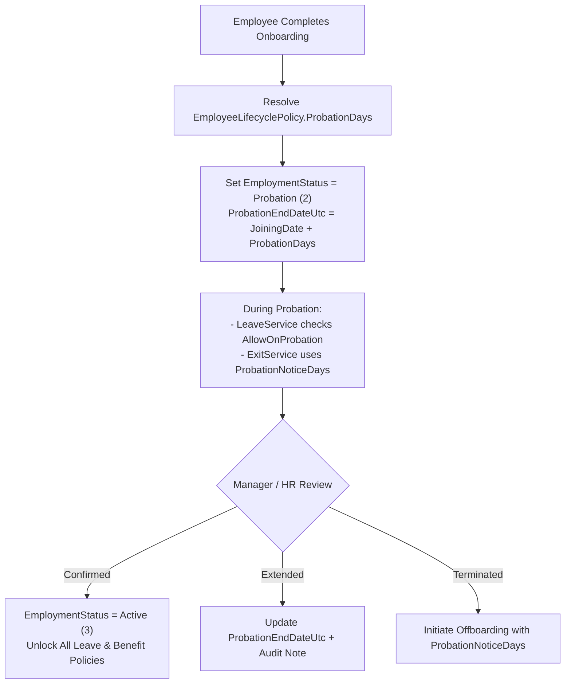
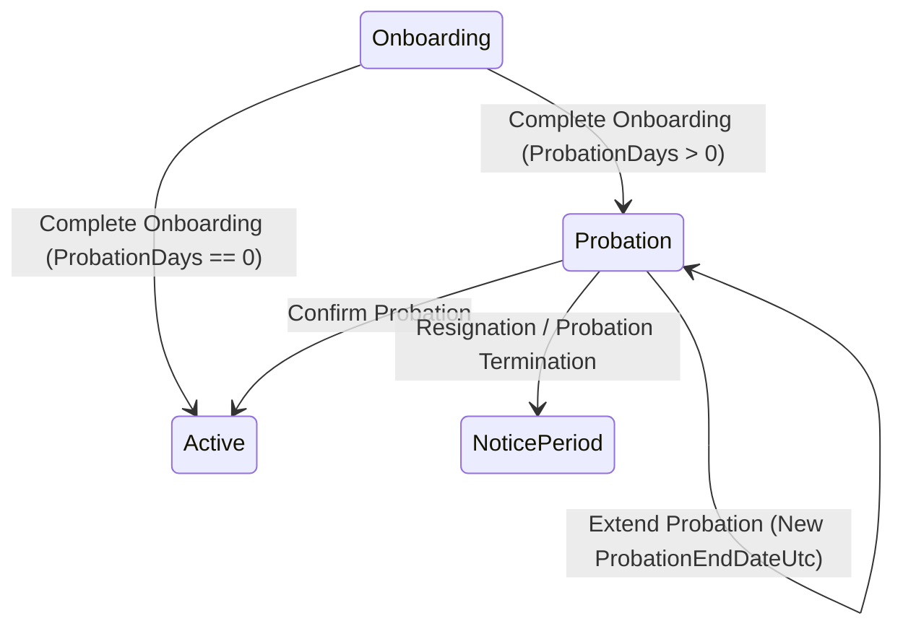

# PROBATION MODULE (`PROBATION.md`)

## 1. Module Overview
The **Probation Module** governs the post-joining evaluation phase (`Probation`) before an employee is confirmed as a permanent staff member (`Active`) or separated under probation notice rules. It connects `EmployeeLifecyclePolicy` probation duration rules (`ProbationDays`), `EmployeeLifecycle` state orchestration (`ProbationEndDateUtc`, `EmploymentStatus`), `LeavePolicy` eligibility (`AllowOnProbation`), and `EmployeeExitPolicy` notice period differentiation (`ProbationNoticeDays` vs `NoticeDays`).

---

## 2. Real-World Business Scenario
1. **Joining on Probation**: When Rahul Sharma completes Day-1 onboarding on `2026-04-01`, `EmployeeLifecycleService` transitions `EmploymentStatus` to `Probation` (`2`) and computes `ProbationEndDateUtc = DateOfJoining + 90 days` (`2026-06-30`) using the company's `EmployeeLifecyclePolicy`.
2. **Probation Restrictions**:
   - While Rahul is in `EmploymentStatus = Probation`, `LeaveManagementService` checks `LeavePolicy.AllowOnProbation`. Casual Leave (`CL`, `AllowOnProbation = true`) is permitted, whereas Earned Leave (`EL`, `AllowOnProbation = false`) is blocked.
   - If Rahul initiates resignation during probation, `OffboardingPolicyResolver` snapshots `ProbationNoticeDays = 15` instead of standard `NoticeDays = 60`.
3. **Confirmation**: Upon reaching `ProbationEndDateUtc` and passing managerial review, HR invokes `POST /api/employee-lifecycle/{id}/confirm-probation`, transitioning `EmploymentStatus` to `Active` (`3`) and unlocking full leave/benefit eligibility.

---

## 3. Actors
| Actor | Role / Capabilities |
|---|---|
| **HR Admin / HR Manager** | Configures `EmployeeLifecyclePolicy.ProbationDays`, monitors employees in `Probation`, extends probation (`ProbationEndDateUtc`), or confirms employment (`Active`). |
| **Reporting Manager** | Reviews probation performance and attendance reliability before confirmation. |
| **Employee (Probationer)** | Views probation status, `ProbationEndDateUtc`, and eligible leave policies in self-service portal. |

---

## 4. Frontend Implementation
| File | Responsibility | Calls | Used By |
|---|---|---|---|
| `src/app/modules/employees/pages/EmployeesPage.tsx` | Displays `EmploymentStatus` badge (`Probation` vs `Active`) and probation filter tabs. | `GET /api/employees` | HR / Admin |
| `src/app/modules/userProfile/UserProfilePage.tsx` | Shows joining date, probation end date, and confirmation status on employee profile. | `GET /api/employee-lifecycle/{id}` | Employee / HR |
| `src/app/modules/settings/pages/LifecyclePolicySettings.tsx` | Configures `ProbationDays` and confirmation rules per company/department/role. | `POST /api/employee-lifecycle/policy` | HR Admin |

---

## 5. Backend Implementation
| Backend File | Responsibility | Dependencies |
|---|---|---|
| `Controllers/EmployeeLifecycleController.cs` | Exposes lifecycle status inspection, probation extension, and confirmation endpoints. | `IEmployeeLifecycleService` |
| `Services/EmployeeLifecycleService.cs` | Evaluates `EmployeeLifecyclePolicy`, sets `ProbationEndDateUtc`, validates transition `Probation -> Active`. | `IMongoRepository<EmployeeLifecycle>`, `IMongoRepository<EmployeeLifecyclePolicy>` |
| `Services/LeaveManagementService.cs` | Enforces `LeavePolicy.AllowOnProbation` against `EmployeeLifecycle.EmploymentStatus == Probation`. | `IMongoRepository<LeavePolicy>`, `IMongoRepository<EmployeeLifecycle>` |
| `Services/OffboardingPolicyResolver.cs` | Applies `ProbationNoticeDays` when an employee exits while in `Probation` state. | `IMongoRepository<EmployeeExitPolicy>` |

---

## 6. API Documentation
| Method | URL | Purpose | Auth / Module Permission | Request / Response | Side Effects |
|---|---|---|---|---|---|
| `GET` | `/api/employee-lifecycle/{employeeId}` | Fetches current 7-dimensional lifecycle record including `ProbationEndDateUtc`. | JWT (`employees:read`) | Returns `EmployeeLifecycleDto` | None |
| `POST` | `/api/employee-lifecycle/{employeeId}/confirm-probation` | Confirms employee from `Probation` (`2`) to `Active` (`3`). | JWT (`employees:update`) | `ConfirmProbationDto` | Updates `EmployeeLifecycle`, logs audit event, sends notification |
| `PUT` | `/api/employee-lifecycle/{employeeId}/extend-probation` | Extends `ProbationEndDateUtc` with mandatory reason. | JWT (`employees:update`) | `ExtendProbationDto` (`NewEndDateUtc`, `Reason`) | Updates `ProbationEndDateUtc`, notifies employee |

---

## 7. Database Model
### `EmployeeLifecycle` & `EmployeeLifecyclePolicy`
- `EmployeeLifecycle.EmploymentStatus`: `Probation = 2`, `Active = 3`
- `EmployeeLifecycle.ProbationEndDateUtc`: `DateTime?`
- `EmployeeLifecyclePolicy.ProbationDays`: `int` (default `90` days)
- `LeavePolicy.AllowOnProbation`: `bool`
- `EmployeeExitPolicy.ProbationNoticeDays`: `int`

---

## 8. Business Rules
- **Business Rule**: Default `ProbationDays` is resolved via `EmployeeLifecyclePolicy` hierarchy (Department+Role -> Department -> Role -> Company).
- **Policy Rule**: Leave types with `AllowOnProbation == false` reject applications if the employee's `EmploymentStatus == EmploymentStatus.Probation`.
- **Policy Rule**: Resignations submitted while `EmploymentStatus == EmploymentStatus.Probation` use `ProbationNoticeDays` instead of `NoticeDays`.
- **State Transition Rule**: Only employees in `EmploymentStatus.Probation` (`2`) or `EmploymentStatus.Onboarding` (`1`) can transition to `EmploymentStatus.Active` (`3`).

---

## 9. Complete Workflow

---

## 10. State Machine

---

## 11. Permissions
- `employees:read` — View probation timeline and status.
- `employees:update` — Confirm or extend probation.
- `settings:update` — Modify `EmployeeLifecyclePolicy.ProbationDays`.

---

## 12. Dependencies
- **Upstream**: `ONBOARDING` (triggers entry into `Probation`), `POLICY` (`EmployeeLifecyclePolicy`).
- **Downstream**: `LEAVE` (`AllowOnProbation` check), `NOTICE-PERIOD` / `OFFBOARDING` (`ProbationNoticeDays`).

---

## 13. Cross-Module Events
- **Probation Confirmation**: Unlocks `LeavePolicy` types where `AllowOnProbation == false` and switches notice requirement from `ProbationNoticeDays` to standard `NoticeDays`.

---

## 14. Failure Scenarios
- **Confirmation Before Joining**: Blocked by state machine validation (`EmploymentStatus` must be `Probation`).
- **Missing Lifecycle Policy**: Falls back to system default (`90` days) if no tenant `EmployeeLifecyclePolicy` exists.

---

## 15. Edge Cases
- **Zero-Day Probation (`ProbationDays == 0`)**: Direct-confirmed senior hires skip `Probation` (`2`) and transition directly from `Onboarding` (`1`) to `Active` (`3`).

---

## 16. Current Strengths
- Tightly integrated with both **Leave Eligibility** (`AllowOnProbation`) and **Exit Notice Calculation** (`ProbationNoticeDays`).

---

## 17. Current Gaps
- Automatic background promotion (`Probation -> Active`) on `ProbationEndDateUtc` expiry is manual rather than driven by an automated hosted service reminder/workflow.

---

## 18. Recommended Improvements
- Add a daily check in `AttendanceReminderHostedService` to notify HR and Reporting Managers 7 days prior to `ProbationEndDateUtc`.

---

## 19. Future Scope
- Structured 30-60-90 day probation review scorecard forms with manager sign-off gates.
