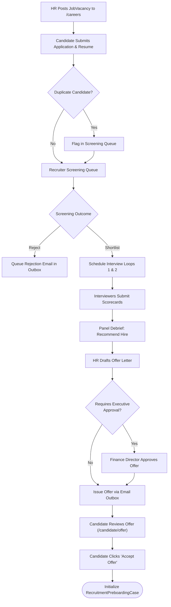
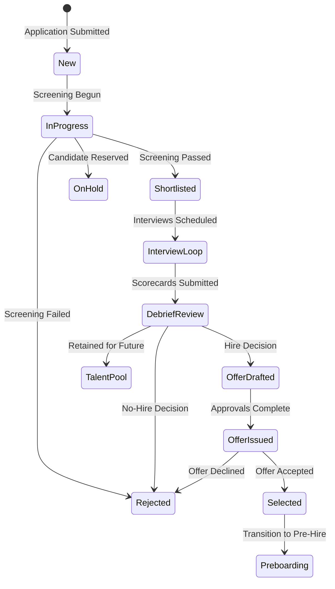

# Module Documentation — Recruitment & Talent Acquisition (`RECRUITMENT`)

> **Document Status**: Complete & Authoritative  
> **Source-of-Truth**: Verified from Repository Implementation  
> **Primary Controllers**: `ApplicantsController.cs`, `JobVacancyController.cs`, `PublicCareerController.cs`, `RecruitmentEnterpriseController.cs`  
> **Primary Services**: 24 Services in `Codeji.CMS.Services.Recruitments`  
> **Primary UI**: `Applications.tsx`, `Jobs.tsx`, `RecruitmentLifecycleDrawer.tsx` (50.6 KB), `RecruitmentSettings.tsx`  
> **Last Verified**: September 2026

---

## 1. Module Overview

- **What the module is**: A full-scale enterprise Applicant Tracking System (ATS) and talent acquisition suite spanning public job posting, applicant sourcing, duplicate detection, resume extraction, structured multi-stage screening, interview planning and debriefs, interviewer scorecards, multi-tier offer approval policies, candidate offer response/negotiation, and talent pool curation.
- **Why HR organizations need it**: Talent acquisition is the entry funnel to the enterprise. Organizations require an auditable, collaborative, and candidate-friendly system to manage requisitions, prevent duplicate applicant submissions, coordinate hiring panels, and issue legally binding offers.
- **What business problem it solves**: Eliminates lost candidate resumes in email threads, inconsistent interview scoring, unbudgeted hiring compensation, and delayed offer letters.
- **Who uses it**: **Recruiters**, **Hiring Managers**, **Interviewers**, **HR Directors**, **Finance Approvers**, and external **Candidates**.
- **Where it fits in the HR lifecycle**: The initial stage (Talent Sourcing & Selection)—seamlessly handing off selected candidates into Preboarding and Onboarding.

---

## 2. Real-World Business Scenario

```text
Company: Codeji Technologies Pvt Ltd
Hiring Role: Senior Distributed Systems Engineer
Candidate: Siddharth Nair
Recruiter: Meera Sen
Hiring Manager: Vikram Malhotra (Engineering Director)
```
1. Vikram submits a `RecruitmentRequisition` for 1 Senior Engineer with a budget ceiling of ₹32 LPA; approved by Finance.
2. Meera creates a `JobVacancy` (Job Code `REQ-ENG-042`) and publishes it to `/careers/codeji`.
3. Siddharth discovers the role on the Public Career Portal, submits his profile, and uploads his resume PDF.
4. **Duplicate Detection Engine**: Automatically verifies Siddharth has not applied to Codeji within the past 90 days.
5. **Screening Queue**: Meera reviews extracted resume metadata, assigns score 4/5, and advances Siddharth to `Shortlisted`.
6. **Interview Loop**: Schedules a 2-stage loop (`System Architecture` with Vikram, `Culture & Leadership` with HR).
7. **Scorecards & Debrief**: Vikram and Meera submit structured scorecards (ratings 1–5 on algorithms, concurrency, teamwork). The panel records a debrief decision: `Recommend Hire`.
8. **Offer Approval & Negotiation**: Meera drafts an offer (₹30 LPA Basic + Allowances, Joining Date: Nov 1st). The offer approval policy routes to the Finance Director for digital sign-off.
9. **Candidate Response**: Siddharth receives an email notification with a secure link to `/candidate/offer`, reviews the formal offer letter, and clicks **Accept Offer**.
10. The accepted offer automatically initializes a `RecruitmentPreboardingCase`.

---

## 3. Supported Actors

| Actor | Capabilities in Module | Server Enforcement |
|---|---|---|
| **Recruiter / HR Manager** | Full operational control: post vacancies, screen candidates, schedule interviews, view all queues, draft offers, manage talent pools. | Enforced via `[ModulePermission(Applications/Jobs, View/Create/Edit)]`. |
| **Hiring / Department Manager** | Reviews requisitions, conducts interview debriefs, reviews applicant resumes for department vacancies. | Scoped to assigned vacancy or department. |
| **Interviewer** | Submits interview scorecards (`RecruitmentScorecard`) for assigned candidates. | Restricted to assigned interview sessions. |
| **Finance / Executive Approver** | Approves or rejects high-value candidate offers based on `RecruitmentOfferApprovalPolicy`. | Gated by offer approval workflow endpoints. |
| **Candidate (Public)** | Searches vacancies, applies via career marketplace, reviews and accepts/rejects offer letters via `/candidate/offer`. | Capability tokens (`PublicApplicationToken`, secure offer links). |

---

## 4. Frontend Implementation

| File | Responsibility | Calls | Used By |
|---|---|---|---|
| `src/app/routing/RecruitmentRoutes.tsx` | Routes: `jobs`, `applications`, `applicant/:applicantid`, `processlog`, `career-profile`. | React Router `<Outlet />` | `PrivateRoutes.tsx` (`/recruitment/*`) |
| `src/app/modules/recruitment/jobs/Jobs.tsx` | Vacancy management grid, status filters (Open, Paused, Closed), requisition drawer. | `recruitmentServices.ts` | `RecruitmentRoutes.tsx` |
| `src/app/modules/recruitment/applications/Applications.tsx` | Kanban and table views of candidate pipelines across all stages. | `recruitmentServices.ts` | `RecruitmentRoutes.tsx` |
| `src/app/modules/recruitment/applications/components/RecruitmentLifecycleDrawer.tsx` (50.6 KB) | Primary candidate cockpit: screening queue, interview scheduling, scorecard reviews, offer issuance, and handoff triggers. | `recruitmentServices.ts` | `Applications.tsx` |
| `src/app/modules/recruitment/RecruitmentSettings.tsx` (17.7 KB) | Configures interview plans, offer approval chains, feedback SLAs, and email templates. | `recruitmentServices.ts` | `PrivateRoutes.tsx` (`/recruitment-settings`) |
| `src/app/modules/recruitment/public/CandidateOfferResponse.tsx` | Public portal for candidate offer letter review, acceptance, or counter-negotiation. | `recruitmentServices.ts` | `AppRoutes.tsx` (`/candidate/offer`) |

---

## 5. Backend Implementation

The backend recruitment subsystem is powered by 24 specialized services in `Codeji.CMS.Services.Recruitments`:

| Backend Service | Architectural Responsibility | Primary Dependencies |
|---|---|---|
| `ApplicantServices.cs` | Manages core `Applicant` and `ApplicantLogs` records, stage transitions. | `IMongoDbRepository<Applicant>` |
| `JobVacancyService.cs` | Vacancy publishing, requirements definition, career portal visibility. | `IMongoDbRepository<JobVacancy>` |
| `RecruitmentApplicationService.cs` | Application creation, duplicate candidate checks, stage progression. | `IMongoDbRepository<RecruitmentJobApplication>` |
| `RecruitmentScreeningQueueService.cs` | Recruiter screening queues, resume rating, qualification matching. | `IMongoDbRepository<RecruitmentScreeningReview>` |
| `RecruitmentInterviewService.cs` | Schedules interview rounds, assigns interviewers, tracks Google Meet/Teams links. | `IMongoDbRepository<RecruitmentInterview>` |
| `RecruitmentScorecardService.cs` | Standardized scoring attributes (1–5 scale), interviewer recommendations. | `IMongoDbRepository<RecruitmentScorecard>` |
| `RecruitmentInterviewDebriefService.cs` | Panel consensus meetings, hire/no-hire consolidated decisions. | `IMongoDbRepository<RecruitmentInterviewPlan>` |
| `RecruitmentOfferService.cs` | Compensation drafting, offer letter HTML generation, expiration windows. | `IMongoDbRepository<RecruitmentOffer>` |
| `RecruitmentOfferApprovalPolicyService.cs`| Multi-stage offer approval gates based on salary thresholds and departments. | `IMongoDbRepository<RecruitmentOfferApprovalPolicy>` |
| `RecruitmentOfferNegotiationService.cs` | Tracks candidate counter-proposals and revision rounds. | `IMongoDbRepository<RecruitmentOffer>` |
| `RecruitmentEmailOutboxProcessor.cs` | Transactional email dispatch for interview invites and offer letters. | `IMongoDbRepository<RecruitmentEmailOutbox>` |
| `RecruitmentDuplicateDetectionService.cs`| Scans matching email hashes, phone numbers, and names across applicants. | `IMongoDbRepository<Applicant>` |
| `RecruitmentTalentPoolService.cs` | Archives silver-medalist candidates into searchable talent pools. | `IMongoDbRepository<RecruitmentTalentPoolMember>` |

---

## 6. API Documentation

| Method | URL | Purpose | Auth / Permission | Request DTO | Validation & Business Logic | Response |
|---|---|---|---|---|---|---|
| `POST` | `/api/JobVacancy/AddEditJobVacancy` | Creates or modifies a job posting. | `[ModulePermission(Jobs, Create/Edit)]` | `JobVacancyModel` | Validates job title, department, employment type, and salary range. | `Result<string>` |
| `POST` | `/api/PublicCareer/ApplyJob` | External candidate job application. | Anonymous (Public) | `ApplyNowVacancyModel` (Multipart) | Rate-limited by IP; validates resume PDF format; triggers duplicate detection. | `Result<string>` |
| `POST` | `/api/RecruitmentScreening/Review` | Submits candidate screening evaluation. | `[ModulePermission(Applications, Review)]`| `RecruitmentScreeningReviewCommand` | Updates screening queue status; advances to Shortlisted or Rejection. | `Result` |
| `POST` | `/api/RecruitmentPlanning/ScheduleInterview`| Schedules an interview round. | `[ModulePermission(Applications, Edit)]` | `RecruitmentInterviewScheduleDto` | Verifies interviewer availability; enqueues calendar invites in outbox. | `Result` |
| `POST` | `/api/RecruitmentPlanning/SubmitScorecard`| Interviewer submits candidate ratings. | `[Authorize]` | `RecruitmentScorecardDto` | Validates all mandatory rating categories are scored; locks scorecard. | `Result` |
| `POST` | `/api/RecruitmentEnterprise/IssueOffer` | Generates official offer letter. | `[ModulePermission(Applications, Create)]`| `RecruitmentOfferCreateCommand` | Verifies offer approval policy sign-offs; generates capability token; queues email. | `Result` |
| `POST` | `/api/PublicCareerEngagement/AcceptOffer` | Candidate digitally accepts offer. | Public Token Auth | `CandidateOfferAcceptanceDto` | Validates token expiration; transitions applicant to `Selected`; initializes preboarding. | `Result` |

---

## 7. Database Model

### Core Entities
1. **`JobVacancy`**: `VacancyId`, `CompanyId`, `JobTitle`, `JobCode`, `DepartmentId`, `EmploymentType`, `MinSalary`, `MaxSalary`, `Slug`, `Status` (`Draft`, `Open`, `Paused`, `Closed`).
2. **`Applicant`**: `ApplicantId`, `CompanyId`, `JobVacancyId`, `FirstName`, `LastName`, `Email`, `PhoneNumber`, `CurrentStage`, `ResumeUrl`, `OverallRating`.
3. **`RecruitmentJobApplication`**: Links applicant to specific vacancy with timeline metadata.
4. **`RecruitmentInterview`**: `InterviewId`, `ApplicantId`, `RoundNumber`, `RoundName`, `ScheduledStartUtc`, `InterviewerUserIds`, `MeetingUrl`, `Status` (`Scheduled`, `Completed`, `Cancelled`).
5. **`RecruitmentScorecard`**: `ScorecardId`, `InterviewId`, `InterviewerUserId`, `Ratings` (`Dictionary<string, int>`), `Recommendation` (`StrongHire`, `Hire`, `NoHire`, `StrongNoHire`).
6. **`RecruitmentOffer`**: `OfferId`, `ApplicantId`, `OfferedCtc`, `JoiningDate`, `ExpiryDate`, `Status` (`Draft`, `PendingApproval`, `Approved`, `Issued`, `Accepted`, `Declined`).
7. **`RecruitmentEmailOutbox`**: Outbox queue for candidate communications.

---

## 8. Business Rules

- **Duplicate Application Guard**: Candidates cannot apply to the same `JobVacancy` with the same email address while an active application is in progress.
- **Offer Approval Gating**: If an offer's `OfferedCtc` exceeds the vacancy's `MaxSalary`, it cannot be issued directly; it must be approved by an authorized Finance or Executive approver in `RecruitmentOfferApprovalPolicy`.
- **Scorecard Non-Repudiation**: Once an interviewer submits a scorecard, it is frozen against further editing to preserve interview panel integrity.

---

## 9. Complete Workflow



---

## 10. State Machine



---

## 11. Permissions

| Action | Admin | HR Manager | Interviewer | Candidate |
|---|:---:|:---:|:---:|:---:|
| Post / Close Vacancy | Yes | Yes | No | No |
| Screen Applications | Yes | Yes | No | No |
| View Assigned Candidate Resume | Yes | Yes | Yes | No |
| Submit Interview Scorecard | Yes | Yes | Yes | No |
| Draft & Approve Offer | Yes | Yes | No | No |
| Accept / Decline Offer | No | No | No | Yes |

---

## 12. Dependencies

- **Depends On**: `CompanyMaster` (`Department`, `CompanyJobRole`), `Roles`.
- **Used By**: `Preboarding`, `Onboarding`, `CoreEmployee`.
- **Reads From**: `Department`, `CompanyJobRole`, `CompanyOfficeLocations`.
- **Writes To**: `JobVacancy`, `Applicant`, `RecruitmentJobApplication`, `RecruitmentInterview`, `RecruitmentScorecard`, `RecruitmentOffer`, `RecruitmentEmailOutbox`.

---

## 13. Cross-Module Events

- Digital offer acceptance by a candidate emits a domain event triggering `RecruitmentPreboardingService.InitializeCase`, establishing the initial pre-hire record.

---

## 14. Failure Scenarios

- **Offer Expiration**: If a candidate attempts to accept an offer past `ExpiryDate`, the API returns HTTP 409 Conflict with message `"Offer has expired. Please contact your recruiter."`
- **Interviewer Outbox Failure**: If the SMTP server is down when scheduling an interview, the outbox record logs the failure and retries automatically without failing the interview scheduling UI action.

---

## 15. Edge Cases

- **Multiple Concurrent Job Applications**: A candidate may apply to two different open vacancies (e.g. `Backend Engineer` and `DevOps Engineer`); each application maintains independent interview plans and scorecards.

---

## 16. Current Strengths

- Full-scale, enterprise-ready ATS pipeline natively integrated with HRMS.
- Deep interview coordination: interviewer scorecards, panel debriefs, and multi-tier offer policies.
- Resilient transactional email dispatching via outbox workers.

---

## 17. Current Gaps

- Automated video call room creation (e.g. Zoom or Google Meet API auto-generation) is not yet integrated; interviewers manually paste meeting links.

---

## 18. Recommended Improvements

- **Medium**: Integrate Google Calendar / Microsoft 365 Graph API for automated interviewer availability calendar lookups.

---

## 19. Future Scope

- AI resume matching algorithm scoring candidates against job description keyword vectors.
