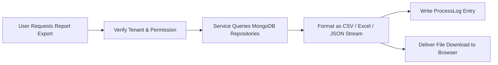

# REPORTING & LOG EXPORT MODULE (`REPORTING.md`)

## 1. Module Overview
The **Reporting & Log Export Module** aggregates operational metrics and audit trails across the system, providing structured CSV and Excel exports, process history inspection (`ProcessLog`), recruitment audit reports (`RecruitmentAuditExportService`), locked monthly attendance summaries, and payroll expenditure registers.

---

## 2. Real-World Business Scenario
1. **Recruitment Audit Export**:
   - For an annual compliance audit, HR Admin exports the complete recruitment history for Q1 2026.
   - `RecruitmentAuditExportService` aggregates applicant transitions, interview scores, and salary offers, streaming a structured CSV report via `GET /api/recruitment/audit-export`.
2. **Payroll Register Export**:
   - Following monthly payroll approval, Finance exports the detailed payroll register containing employee names, bank account numbers, gross earnings, LOP deductions, statutory EPF/ESIC, and net payable amounts.

---

## 3. Actors
| Actor | Capabilities |
|---|---|
| **HR Admin / Payroll Admin** | Generates and downloads attendance, payroll, leave, and recruitment reports. |
| **Finance / External Auditor** | Reviews compliance registers and financial disbursement sheets. |

---

## 4. Frontend Implementation
| File | Responsibility | Calls | Used By |
|---|---|---|---|
| `src/app/modules/reports/pages/ReportsDashboard.tsx` | Central reporting hub with export cards for Attendance, Payroll, Leave, and Hiring. | `GET /api/reports/available` | HR / Finance |
| `src/app/modules/attendance/EmployeeAttendance.tsx` | Monthly attendance report view with calendar grid, punch modal, and 4-tab Excel export trigger. | `GET /api/admin/attendance/export/monthly` | HR / Admin |
| `src/app/modules/payroll/components/PayRollTable.tsx` | Monthly payroll register with disbursement audit, bank export trigger, and payslip downloads. | `GET /api/payroll/reports/bank-disbursement` | Accounts / HR |
| `src/app/modules/recruitment/components/RecruitmentAuditExportModal.tsx` | Dialog to select date ranges and trigger recruitment audit CSV download. | `GET /api/recruitment/audit-export` | HR Admin |

---

## 5. Backend Implementation
| Backend File | Responsibility | Dependencies |
|---|---|---|
| `Services/AttendanceService.cs` | `ExportMonthlyAttendanceAsync` generates closedXML 4-tab workbook (`Attendance Muster`, `Daily Punch Logs`, `Monthly Summary`, `Legend & Policy`) with sanitized remarks and pastel styling. | `IMongoDbRepository<EmpUser>`, `IAttendanceRepository`, `IMongoDbRepository<AttendanceDaySegment>`, `ICompanyWorkingCalendarService` |
| `Controllers/PayrollReportsController.cs` | Exposes bank disbursement reports, variance comparisons, and cost center summaries. | `IPayrollReportsService` |
| `Services/RecruitmentAuditExportService.cs` | Streams applicant history, stage progressions, and interviewer remarks as formatted CSV. | `IMongoRepository<Applicant>`, `IMongoRepository<ApplicantLogs>` |
| `Controllers/AutoPayrollController.cs` | Exposes monthly payroll summary reports and export registers. | `IAutoPayrollServices` |
| `Controllers/AttendanceController.cs` | Exposes locked `MonthlyAttendanceSummary` datasets and monthly muster export stream. | `IAttendanceService` |

---

## 6. API Documentation
| Method | URL | Purpose | Auth / Permission | Request / Response | Side Effects |
|---|---|---|---|---|---|
| `GET` | `/api/admin/attendance/export/monthly?year={y}&month={m}` | Exports production-ready 4-tab Excel workbook (`attendance-report-YYYY-MM.xlsx`). | JWT (`attendance:read`) | Stream `application/vnd.openxmlformats-officedocument.spreadsheetml.sheet` | Generates 4 worksheets: Muster, Punch Logs, Payroll Summary, Legend |
| `GET` | `/api/recruitment/audit-export` | Streams recruitment audit log CSV file. | JWT (`recruitment:read`) | Streams `text/csv` | Logs export audit event |
| `GET` | `/api/autopayroll/records` | Exports employee-level payroll breakdown for target month/year. | JWT (`payroll:read`) | `List<PayrollEntityDto>` | None |
| `GET` | `/api/payroll/reports/bank-disbursement?year={y}&month={m}` | Generates bank-compliant disbursement transfer register with account numbers and net pay. | JWT (`payroll:read`) | `BankDisbursementReportDto` | None |
| `GET` | `/api/attendance/monthly-summary` | Retrieves complete monthly attendance summaries for company employees. | JWT (`attendance:read`) | `List<MonthlyAttendanceSummaryDto>` | None |

---

## 7. Database Model
### `ProcessLog` & Operational Summaries
- `ProcessLog`:
  - `Id` (`string`, PK)
  - `CompanyId` (`string`, FK)
  - `ProcessType` (`string`, `"Payroll"` | `"AttendanceLock"` | `"LeaveAccrual"`)
  - `Status` (`string`, `"Success"` | `"Warning"` | `"Failed"`)
  - `Message` (`string`)
  - `ExecutedBy` (`string`)
  - `ExecutionTimeUtc` (`DateTime`)

---

## 8. Business Rules
- **Export Isolation Rule**: Every report query strictly filters on `CompanyId` from the authenticated user context.
- **Audit Logging Rule**: Sensitive exports (such as salary registers and recruitment audit logs) write an entry to `ProcessLog` or audit collections.

---

## 9. Complete Workflow

---

## 10. State Machine
Reports represent point-in-time idempotent query executions.

---

## 11. Permissions
- `reports:read` / `payroll:read` / `recruitment:read` — Access respective report generation endpoints.

---

## 12. Dependencies
- **Upstream**: All transactional modules (`RECRUITMENT`, `ATTENDANCE`, `PAYROLL`, `LEAVE`).
- **Downstream**: External spreadsheet tools, auditors, and banking systems.

---

## 13. Cross-Module Events
- Executing an export writes an audit trail entry.

---

## 14. Failure Scenarios
- **Large Dataset Timeout**: Handled by streaming CSV responses directly to the HTTP output stream rather than buffering entire datasets in memory.

---

## 15. Edge Cases
- **Exports During In-Flight Payroll**: Unlocked/draft payroll records are explicitly demarcated with `IsLocked = false` warning headers.

---

## 16. Current Strengths
- Direct streaming of audit records reduces server memory overhead during large exports.

---

## 17. Current Gaps
- Scheduled recurring report emails (e.g., auto-emailing Monday morning attendance summaries to executive staff) are not yet scheduled via a cron hosted service.

---

## 18. Recommended Improvements
- Add scheduled email reports via a `ReportSchedulerHostedService`.

---

## 19. Future Scope
- Customizable visual report builder with drag-and-drop column selection.
