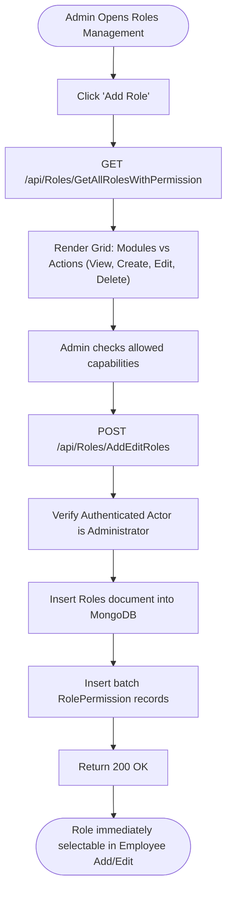
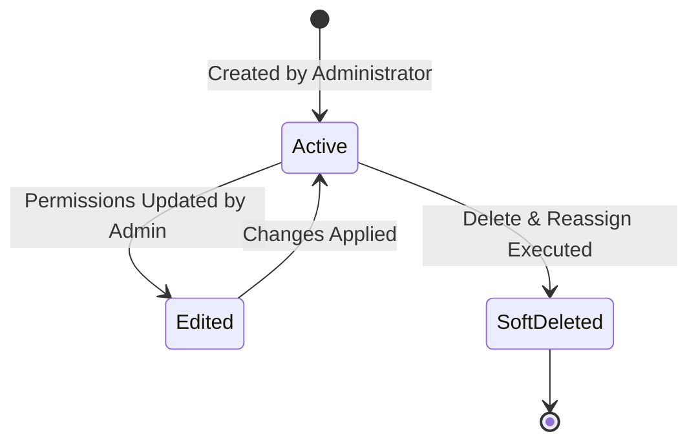

# Module Documentation — Role & Permission Management (`ROLE-PERMISSION`)

> **Document Status**: Complete & Authoritative  
> **Source-of-Truth**: Verified from Repository Implementation  
> **Primary Controller**: `RolesController.cs`  
> **Primary Service**: `RoleServices.cs` (35.4 KB, 706 lines)  
> **Primary Frontend Components**: `Roles.tsx`, `AddPermission.tsx`, `EditPermission.tsx`  
> **Last Verified**: September 2026

---

## 1. Module Overview

- **What the module is**: The security authorization engine that manages corporate Roles and configures fine-grained access control matrices across all application modules.
- **Why HR organizations need it**: Enterprises employ diverse organizational roles (HR Directors, Recruiters, Payroll Accountants, Department Managers, Staff Employees). Each role must be restricted strictly to its operational remit to prevent unauthorized access to sensitive financial, personal, or separation records.
- **What business problem it solves**: Eliminates coarse, all-or-nothing administrative privileges by providing a granular, multi-tenant permission matrix.
- **Who uses it**: Exclusively **Company Administrators** (`Roles.Administrator`).
- **Where it fits in the HR lifecycle**: Core governance framework—evaluated continuously on every single authenticated request across all modules.

---

## 2. Real-World Business Scenario

```text
Company: Nexa Enterprise Systems
Administrator: Devraj Patel (Administrator)
Scenario: Creating a specialized 'Recruiter' role restricted to Talent Acquisition
```
1. Devraj navigates to `/admin/roles` and clicks **Add Role**.
2. Enters Role Title `Talent Acquisition Specialist` and Description `Responsible for posting jobs and reviewing candidate applications`.
3. In the permission matrix grid:
   - **Jobs**: Grants `View`, `Create`, `Edit`.
   - **Applications**: Grants `View`, `Create`, `Edit`, `Scorecard`, `Review`.
   - **Employees**: Grants `View` (Read-only directory).
   - **PayRoll & Settings**: Leaves completely unchecked (`HasAccess = false`).
4. Clicks **Save**. The backend creates a new `Roles` document and persists explicit `RolePermission` records.
5. Devraj assigns this new role to the newly hired recruiter; when the recruiter logs in, the navigation sidebar automatically hides Payroll, Attendance Settings, and Separation Clearances.

---

## 3. Supported Actors

| Actor | Capabilities in Module | Server Enforcement |
|---|---|---|
| **Company Administrator** | Full authority to create custom roles, edit permission matrices, and delete/reassign roles. | Enforced via `ProtectedRoute adminOnly={true}` and backend checks. |
| **Non-Admin Actors (HR, Manager, Employee)** | Cannot access `/admin/roles`; permissions are resolved dynamically from their assigned role. | Access to `/admin/roles` returns HTTP 403 Forbidden. |

---

## 4. Frontend Implementation

| File | Responsibility | Calls | Used By |
|---|---|---|---|
| `src/app/modules/admin/permissions/Roles.tsx` | Displays table of all company roles with employee counts, edit actions, and delete triggers. | `roleServices.ts` | `adminRoutes.tsx` (`/admin/roles`) |
| `src/app/modules/admin/permissions/components/AddPermission.tsx` | Form for authoring a new role and configuring its Cartesian permission matrix across modules. | `roleServices.ts` | `adminRoutes.tsx` (`/admin/roles/add`) |
| `src/app/modules/admin/permissions/components/EditPermission.tsx` | Form for modifying role titles, descriptions, and toggling module-level checkboxes. | `roleServices.ts` | `adminRoutes.tsx` (`/admin/roles/edit/:roleid`) |

---

## 5. Backend Implementation

| Backend File | Responsibility | Dependencies |
|---|---|---|
| `Codeji.CMS.API/Controllers/RolesController.cs` | Endpoints for listing roles, fetching permission trees, adding/editing roles, and reassigning roles on deletion. | `IRoleService`, `IHttpContextAccessor` |
| `Codeji.CMS.Services/Employees/RoleServices.cs` (35.4 KB) | Core RBAC service: builds permission matrices, executes `VerifyUserAccess`, seeds default roles, and manages role reassignment. | `IMongoDbRepository<Roles>`, `IMongoDbRepository<RolePermission>`, `IMongoDbRepository<ModulePermission>` |

---

## 6. API Documentation

| Method | URL | Purpose | Auth / Permission | Request DTO | Validation & Business Logic | Response |
|---|---|---|---|---|---|---|
| `GET` | `/api/Roles/GetAllRoles` | Returns all active roles for the current company. | `[Authorize]` + Admin | Query Params | Filters by `x.CompanyId == companyId && !x.IsDeleted`. | `Result<RoleModel>` |
| `GET` | `/api/Roles/GetAllRolesWithPermission` | Returns full module-by-permission tree with active checkboxes. | `[Authorize]` + Admin | Query Params | Joins `Module`, `Permission`, `ModulePermission`, and `RolePermission`. | `Result<ModuleWithPermissionsModel>` |
| `POST` | `/api/Roles/AddEditRoles` | Creates or updates a role and its permission checklist. | `[Authorize]` + Admin | `RoleWithModuleAndPermissions` | Prevents editing roles marked `IsNotEditable == true` (Administrator). | `Result` |
| `POST` | `/api/Roles/DeleteAndReassignRole` | Deletes a role and safely reassigns linked employees to another role. | `[Authorize]` + Admin | `DeleteAndReassignRoleRequestModel` | Verifies target replacement role exists; updates all `EmpUser.RoleId` records before soft-deleting old role. | `Result` |

---

## 7. Database Model

### Entities
1. **`Roles`** (`Codeji.CMS.Repository.Entities.RolePermissions.Roles`)
   - **Primary Key**: `RolesId`
   - **Fields**: `CompanyId`, `RoleType`, `Titles`, `Description`, `HasAppAccess`, `IsNotEditable`, `IsDeleted`.
2. **`Module`** (`Codeji.CMS.Repository.Entities.RolePermissions.Module`)
   - **Primary Key**: `ModuleId`
   - **Fields**: `ModuleName`, `ModuleConstant`, `SortOrder`.
3. **`Permission`** (`Codeji.CMS.Repository.Entities.RolePermissions.Permission`)
   - **Primary Key**: `PermissionId`
   - **Fields**: `PermissionName`, `PermissionConstant`.
4. **`ModulePermission`** (`Codeji.CMS.Repository.Entities.RolePermissions.ModulePermission`)
   - **Primary Key**: `ModulePermissionId`
   - **Fields**: `ModuleId`, `PermissionId`.
5. **`RolePermission`** (`Codeji.CMS.Repository.Entities.RolePermissions.RolePermission`)
   - **Primary Key**: `RolePermissionId`
   - **Fields**: `CompanyId`, `RoleId`, `ModulePermissionId`, `HasAccess` (Boolean).

---

## 8. Business Rules

- **Administrator Immutability**: Roles with `IsNotEditable == true` (the standard Company Administrator role) cannot be edited or deleted.
- **Safe Role Deletion**: A role cannot be deleted without providing a valid `ReassignRoleId`. All employees currently holding the deleted role are atomically migrated to the replacement role.
- **Tenant Scope Rule**: `RolePermission` records are strictly scoped to `CompanyId`. Custom permissions configured in Company A have zero effect on Company B.

---

## 9. Complete Workflow



---

## 10. State Machine



---

## 11. Permissions

| Action | Admin | HR Manager | Reporting Manager | Employee |
|---|:---:|:---:|:---:|:---:|
| Access `/admin/roles` | Yes | No | No | No |
| Create New Role | Yes | No | No | No |
| Modify Role Permissions | Yes | No | No | No |
| Delete & Reassign Role | Yes | No | No | No |

---

## 12. Dependencies

- **Depends On**: `Company`, `Module`, `Permission`, `ModulePermission`.
- **Used By**: All modules via `CompanyIdMiddleware` and `RoleServices.VerifyUserAccess`.
- **Reads From**: `Roles`, `RolePermission`, `ModulePermission`, `Module`, `Permission`, `EmpUser`.
- **Writes To**: `Roles`, `RolePermission`, `EmpUser` (during role reassignment).

---

## 13. Cross-Module Events

- Deleting a role and reassigning it to another role updates all affected `EmpUser` documents, altering their effective permissions immediately upon their next API request.

---

## 14. Failure Scenarios

- **Orphaned User Prevention**: If an administrator attempts to delete a role without supplying a valid `ReassignRoleId`, the API rejects the request with HTTP 400 Bad Request, preventing employees from having dangling role references.

---

## 15. Edge Cases

- **Self-Lockout Prevention**: An administrator cannot delete or reassign their own active Administrator role.

---

## 16. Current Strengths

- Dynamic, database-backed permission matrix eliminates code deployments when creating new roles.
- Mandatory role reassignment protects referential integrity during role deletion.

---

## 17. Current Gaps

- Permissions are module-level and action-level; field-level permissions (e.g. masking salary on profile while showing other fields) are not natively configurable in the UI grid.

---

## 18. Recommended Improvements

- **Medium**: Add field-level read/write masking toggles in the permission matrix for sensitive personal attributes.

---

## 19. Future Scope

- Attribute-Based Access Control (ABAC) support combining dynamic role checks with contextual attributes (e.g., location or IP subnet).
