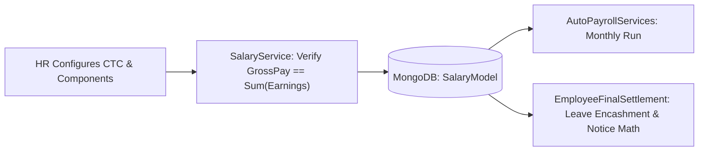

# SALARY STRUCTURE & COMPENSATION MODULE (`SALARY.md`)

## 1. Module Overview
The **Salary Structure & Compensation Module** manages employee compensation packages (`SalaryModel`), decomposing annual Cost-to-Company (`CTC`) into monthly earning heads (`BasicPay`, `HRA`, `LTA`, `Bonus`, `OtherAllowance`) and statutory/benefit deduction heads (`EPF`, `ESIC`, `HealthInsurance`, `IncomeTax`). It provides the foundational financial dataset consumed by `AutoPayrollServices` and `EmployeeFinalSettlement`.

---

## 2. Real-World Business Scenario
1. **Compensation Setup during Onboarding / Promotion**:
   - HR Manager assigns Rahul Sharma's salary structure via `SalaryController` (`POST /api/salary`):
     - Annual `CTC` = `₹12,00,000`
     - Monthly `GrossPay` = `₹1,00,000` (`BasicPay = ₹50,000`, `HRA = ₹25,000`, `LTA = ₹10,000`, `OtherAllowance = ₹15,000`)
     - Fixed Monthly Deductions: `EPF = ₹1,800`, `HealthInsurance = ₹1,500`, `IncomeTax = ₹8,200`.
2. **Monthly Consumption**:
   - Every month, `AutoPayrollServices` reads Rahul's active `SalaryModel` via `SalaryRepository` to compute earnings, LOP rate, and statutory deductions.

---

## 3. Actors
| Actor | Capabilities |
|---|---|
| **HR Admin / Payroll Admin** | Creates and revises employee `SalaryModel` structures, views CTC breakdowns. |
| **Employee** | Views personal salary structure breakdown on profile/payroll portal. |

---

## 4. Frontend Implementation
| File | Responsibility | Calls | Used By |
|---|---|---|---|
| `src/app/modules/payroll/pages/SalaryStructurePage.tsx` | Form and calculator for defining employee CTC, Basic, HRA, LTA, Allowances, and Deductions. | `GET /api/salary/{employeeId}`, `POST /api/salary`, `PUT /api/salary/{id}` | HR / Payroll Admin |
| `src/app/modules/userProfile/components/CompensationTab.tsx` | Read-only breakdown of earnings and deductions for the logged-in employee. | `GET /api/salary/my-structure` | Employee |

---

## 5. Backend Implementation
| Backend File | Responsibility | Dependencies |
|---|---|---|
| `Controllers/SalaryController.cs` | Endpoints for creating, updating, and querying employee salary structures. | `ISalaryService` |
| `Services/SalaryService.cs` | Validates component totals (`GrossPay == sum(Earnings)`), persists `SalaryModel`, and tracks compensation revisions. | `ISalaryRepository`, `IMongoRepository<SalaryModel>` |
| `Repository/SalaryRepository.cs` | Specialized repository for querying active employee `SalaryModel` records by `CompanyId` and `EmployeeId`. | `MongoDbContext` |

---

## 6. API Documentation
| Method | URL | Purpose | Auth / Permission | Request / Response | Side Effects |
|---|---|---|---|---|---|
| `GET` | `/api/salary/{employeeId}` | Fetches active `SalaryModel` for an employee. | JWT (`payroll:read`) | `SalaryModelDto` | None |
| `POST` | `/api/salary` | Creates initial salary structure for an employee. | JWT (`payroll:create`) | `CreateSalaryModelDto` | Persists `SalaryModel` |
| `PUT` | `/api/salary/{id}` | Updates/revises an employee's salary components. | JWT (`payroll:update`) | `UpdateSalaryModelDto` | Updates `SalaryModel`, increments `Version` |

---

## 7. Database Model
### `SalaryModel` (`CMS-Backend-Core/Codeji.CMS.Repository/Entities/SalaryModel.cs`)
- `Id` (`string`, PK)
- `CompanyId` (`string`, FK)
- `EmployeeId` (`string`, FK)
- `CTC` (`double`)
- `GrossPay` (`double`)
- `BasicPay` (`double`)
- `HRA` (`double`)
- `LTA` (`double`)
- `Bonus` (`double`)
- `OtherAllowance` (`double`)
- `EPF` (`double`)
- `ESIC` (`double`)
- `HealthInsurance` (`double`)
- `IncomeTax` (`double`)
- `EffectiveFrom` (`DateTime`)
- `IsActive` (`bool`)

---

## 8. Business Rules
- **Component Identity Rule**:
  $$\text{GrossPay} = \text{BasicPay} + \text{HRA} + \text{LTA} + \text{Bonus} + \text{OtherAllowance}$$
- **Non-Negative Rule**: All earning and deduction heads must be $\ge 0$, and `NetPay` before LOP must be $> 0$.
- **Single Active Structure Rule**: Each employee has at most one active `SalaryModel` (`IsActive == true`) at any point in time.

---

## 9. Complete Workflow

---

## 10. State Machine
`Draft` $\rightarrow$ `Active` (`IsActive = true`) $\rightarrow$ `Superseded` (upon appraisal/revision).

---

## 11. Permissions
- `payroll:read` — View salary structures.
- `payroll:create` / `payroll:update` — Create or revise employee compensation structures.

---

## 12. Dependencies
- **Upstream**: `EMPLOYEE` (`EmpUser`), `RECRUITMENT` (`JobOffer.OfferedCtc`).
- **Downstream**: `PAYROLL` (`AutoPayrollServices`), `BENEFITS`, `FINAL-SETTLEMENT`.

---

## 13. Cross-Module Events
- Creating a `SalaryModel` sets `EmployeeLifecycle.PayrollStatus = Eligible` so the employee is included in the next `AutoPayrollServices` run.

---

## 14. Failure Scenarios
- **Missing SalaryModel During Payroll**: `AutoPayrollServices` skips or flags employees who do not have an active `SalaryModel` configured.

---

## 15. Edge Cases
- **Mid-Month Salary Revision**: Effective date tracking (`EffectiveFrom`) determines which structure applies to the current payroll period.

---

## 16. Current Strengths
- Clean componentized representation of Indian statutory and allowance heads (`BasicPay`, `HRA`, `LTA`, `EPF`, `ESIC`, `HealthInsurance`, `IncomeTax`).

---

## 17. Current Gaps
- Percentage-based formula templates (e.g., auto-calculating `Basic = 50% of CTC`, `HRA = 50% of Basic`) are computed in the UI form rather than stored as reusable backend grade templates.

---

## 18. Recommended Improvements
- Introduce `SalaryStructureTemplate` entities per designation/grade for 1-click compensation assignment.

---

## 19. Future Scope
- Multi-revision arrears calculation engine for retroactive appraisal back-pay.
