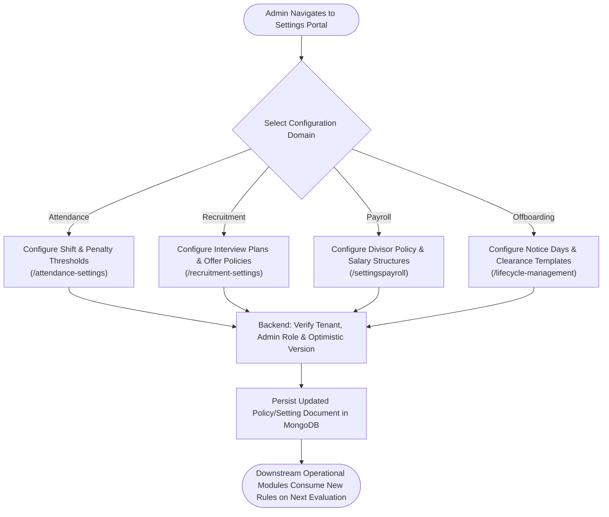
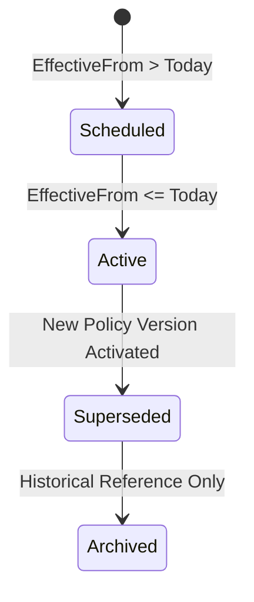

# Module Documentation — Centralized System Settings Index (`SETTINGS`)

> **Document Status**: Complete & Authoritative  
> **Source-of-Truth**: Verified from Repository Implementation  
> **Scope**: Cross-Module Configuration Hubs (`Company`, `Attendance`, `Payroll`, `Recruitment`, `Lifecycle`, `User`)  
> **Last Verified**: September 2026

---

## 1. Module Overview

- **What the module is**: The comprehensive index and operational framework of all administrative and user-level configuration workspaces distributed across the Codeji HRMS platform.
- **Why HR organizations need it**: Rather than burying module parameters inside operational forms, Codeji provides dedicated settings portals for Company Branding, Master Taxonomies, Attendance Statuses, Recruitment SLAs/Policies, Payroll Divisor & Salary Structures, and Lifecycle/Exit Policies.
- **What business problem it solves**: Provides clear separation of duties between **Configuration Authors** (Administrators/HR Directors) and **Operational Executors** (Recruiters, Managers, Employees).
- **Who uses it**: **Company Administrators**, **HR Managers**, and **Employees** (for personal user settings).
- **Where it fits in the HR lifecycle**: Governs the behavioral parameters of every operational stage.

---

## 2. Real-World Business Scenario

```text
Organization: Meridian FinTech Solutions
Administrator: Karan Malhotra
Scenario: Annual Fiscal Year Rollover & Policy Recalibration
```
1. At the start of the new fiscal year, Karan visits the 5 primary administrative settings portals:
   - **Payroll Settings (`/settingspayroll`)**: Updates the company divisor policy from `CALENDAR_DAYS` to `FIXED_30_DAYS` effective April 1st, and revises salary structures for promoted engineers.
   - **Attendance Settings (`/attendance-settings`)**: Configures the grace period to 15 minutes and sets the monthly late arrival threshold (`CombinedLhdEdMonthlyLimit`) to 3 occurrences.
   - **Recruitment Settings (`/recruitment-settings`)**: Configures interview feedback SLA to 48 hours and establishes a two-stage Offer Approval Policy for salaries above ₹25 LPA.
   - **Lifecycle Settings (`/lifecycle-management?view=policies`)**: Reviews probation confirmation durations (6 months) and offboarding notice periods (60 days for Engineering, 30 days for Operations).

---

## 3. Supported Actors

| Actor | Settings Portals Accessible | Server Enforcement |
|---|---|---|
| **Company Administrator** | All settings portals (`/admin/*`, `/attendance-settings`, `/recruitment-settings`, `/settingspayroll`, `/lifecycle-management`, `/profile/setting`). | `ProtectedRoute adminOnly={true}` and backend `[Authorize(Policy = "AdminOnly")]`. |
| **HR Manager** | `/settingspayroll`, `/lifecycle-management`, `/profile/setting`. | Enforced via `[ModulePermission(PayrollSettings/Employees, View/Edit)]`. |
| **Employee** | `/profile/setting` (Personal security & notification preferences only). | Blocked from all company-level configuration routes. |

---

## 4. Frontend Implementation

| File | Route Path | Responsibility |
|---|---|---|
| `src/app/modules/admin/companymaster/CompanyMaster.tsx` | `/admin/companymaster/*` | Departments, Job Roles, Office Locations, Working Days, Custom Attributes, ID Sequences. |
| `src/app/modules/admin/companydetails/CompanyDetails.tsx` | `/admin/companydetails/*` | Corporate identity, Logo upload, Legal tax numbers, SMTP Email server configuration. |
| `src/app/modules/attendance/AttendanceStatusSettings.tsx` | `/attendance-settings` | Attendance status labels (`P`, `HD`, `LHD`, `ED`), hex colors, and office schedule shifts. |
| `src/app/modules/recruitment/RecruitmentSettings.tsx` | `/recruitment-settings` | Interview plans, offer approval policies, feedback SLA timers, and email templates. |
| `src/app/modules/payrollsettings/PayrollSettings.tsx` | `/settingspayroll` | Employee salary structures (`SalaryTable.tsx`) and monthly payroll divisor policies. |
| `src/app/modules/users/components/EmployeeExitPolicySettings.tsx`| `/lifecycle-management` | Offboarding notice rules, buyout divisors, and multi-department clearance templates. |
| `src/app/modules/users/usersetting/Setting.tsx` | `/profile/setting` | Personal password change and notification channel preferences. |

---

## 5. Backend Implementation

| Backend Controller | Managed Entities | Primary Service |
|---|---|---|
| `CompanyMasterController.cs` | `Department`, `CompanyJobRole`, `CompanyOfficeLocations`, `CompanyWorkingDays` | `CompanyMasterService.cs` |
| `CompanyController.cs` | `Company`, `CompanyEmailSettings`, `EmployeeIdSequence` | `CompanyService.cs` |
| `AttendanceStatusSettingsController.cs`| `AttendanceStatusSetting`, `CompanyOfficeSchedule` | `AttendanceStatusService.cs`, `OfficeScheduleSettingsService.cs` |
| `PayrollDivisorPolicyController.cs` | `PayrollDivisorPolicy`, `SalaryModel` | `PayrollDivisorPolicyService.cs`, `SalaryService.cs` |
| `RecruitmentEnterpriseController.cs` | `RecruitmentOfferApprovalPolicy`, `RecruitmentInterviewPlan` | `RecruitmentOfferApprovalPolicyService.cs` |
| `UserController.cs` | `EmployeeExitPolicy`, `EmployeeExitClearanceTemplate` | `EmployeeService.cs` |

---

## 6. API Documentation Summary

| Domain | Endpoint | Method | Purpose |
|---|---|---|---|
| **Attendance** | `/api/AttendanceStatusSettings/GetSettings` | `GET` | Fetches tenant attendance status colors and labels. |
| **Shifts** | `/api/Attendance/SaveOfficeSchedule` | `POST` | Saves company or department shift timings and grace periods. |
| **Payroll** | `/api/PayrollDivisorPolicy/SavePolicy` | `POST` | Configures `FIXED_30_DAYS`, `WORKING_DAYS`, or `CALENDAR_DAYS`. |
| **Recruitment**| `/api/RecruitmentPlanning/SaveOfferApprovalPolicy`| `POST` | Defines approval chains for high-value candidate offers. |
| **Offboarding**| `/api/User/SaveEmployeeExitPolicy` | `POST` | Saves department/role-scoped exit notice and clearance rules. |

---

## 7. Database Model

All settings entities include `CompanyId`, `Version` (for optimistic concurrency), `EffectiveFrom` / `EffectiveTo` date windows (where temporal versioning applies), and standard audit fields (`CreatedBy`, `CreatedDate`, `UpdatedBy`, `UpdatedDate`).

---

## 8. Business Rules

- **Temporal Versioning Rule**: Changes to `PayrollDivisorPolicy` and `AttendancePenaltyPolicy` require an `EffectiveFrom` date and cannot retroactively mutate already locked attendance months or processed payroll runs.
- **Immutable Snapshot Rule**: Changes to `EmployeeExitPolicy` apply only to newly initiated separation cases; inflight exit cases retain their embedded `PolicySnapshot`.

---

## 9. Complete Workflow



---

## 10. State Machine

Settings records transition through temporal lifecycle states:


---

## 11. Permissions

| Setting Portal | Admin | HR Manager | Reporting Manager | Employee |
|---|:---:|:---:|:---:|:---:|
| `/admin/companymaster` | Yes | No | No | No |
| `/admin/companydetails` | Yes | No | No | No |
| `/attendance-settings` | Yes | No | No | No |
| `/recruitment-settings` | Yes | No | No | No |
| `/settingspayroll` | Yes | Yes | No | No |
| `/lifecycle-management` | Yes | Yes | No | No |
| `/profile/setting` | Yes | Yes | Yes | Yes |

---

## 12. Dependencies

- **Depends On**: `Company`, `Roles`.
- **Used By**: Every operational module across the platform.

---

## 13. Cross-Module Events

- Updating `RecruitmentSettings` feedback SLA thresholds immediately adjusts overdue indicators on `RecruitmentFeedbackSlaCard.tsx`.
- Updating `PayrollSettings` divisor policies alters the daily salary rate calculation in the next `AutoPayrollServices` run.

---

## 14. Failure Scenarios

- **Overlapping Effective Dates**: Attempting to save an `AttendancePenaltyPolicy` whose `[EffectiveFrom, EffectiveTo]` date range overlaps an existing policy for the same employee/scope returns a validation error: `"The effective dates overlap an existing policy."`

---

## 15. Edge Cases

- **Unconfigured Tenant Defaults**: If a newly registered tenant has not manually visited `/attendance-settings` or `/settingspayroll`, the system gracefully resolves safe system defaults (`CALENDAR_DAYS` divisor, 0 grace minutes, 30-day notice period) via fallback rules.

---

## 16. Current Strengths

- Dedicated, modular configuration screens prevent administrative clutter in daily operational views.
- Strong temporal date-window validation prevents overlapping policy ambiguities.

---

## 17. Current Gaps

- Settings routes are accessed via distinct sidebar items (`/admin/*`, `/attendance-settings`, `/recruitment-settings`, `/settingspayroll`) rather than a single unified "Settings Control Center" landing page.

---

## 18. Recommended Improvements

- **Low (P3)**: Create a unified `/settings` hub dashboard with quick-navigation cards linking to all 6 domain configuration portals.

---

## 19. Future Scope

- Configuration export/import (JSON/YAML Infrastructure-as-Code templates) allowing enterprises to clone settings from a staging tenant to a production tenant.
