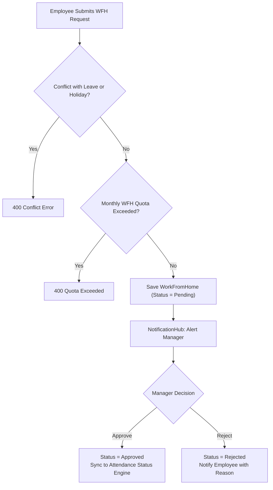
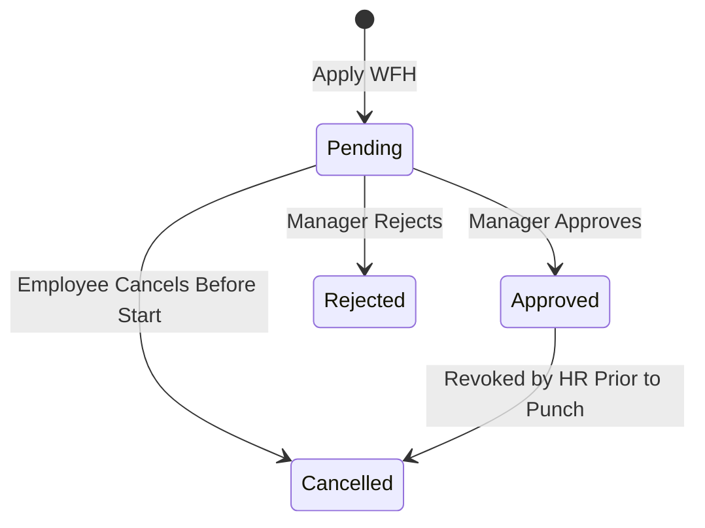

# WORK FROM HOME (WFH) MODULE (`WFH.md`)

## 1. Module Overview
The **Work From Home (WFH) Module** regulates remote work applications, manager approvals, monthly WFH allowances/quotas, half-day remote shifts, and their overlay onto `AttendanceStatusCalculationService`. It ensures remote work days are credited toward attendance hours while maintaining compliance with company remote work policies.

---

## 2. Real-World Business Scenario
1. **Application**: On Monday evening, Rahul Sharma submits a WFH request for Wednesday (`2026-04-15`) due to personal logistics. He selects `IsHalfDay = false` and supplies a reason.
2. **Manager Approval**: Rahul's reporting manager receives a real-time notification via `NotificationHub` and approves the request (`POST /api/wfh/{id}/approve`).
3. **Attendance Execution**: On Wednesday, Rahul logs into the system remotely. Because an `Approved` WFH record exists for that date, `AttendanceStatusCalculationService` recognizes remote attendance, logs the IP/punch time, and marks the day as present with WFH designation, preventing late arrival penalties or unauthorized absence.

---

## 3. Actors
| Actor | Capabilities |
|---|---|
| **Employee** | Submits WFH requests (full day or half-day), tracks status, cancels pending requests. |
| **Reporting Manager** | Approves or rejects subordinate WFH applications with review comments. |
| **HR Admin** | Configures tenant-wide or department WFH quota limits, reviews organization-wide remote work trends. |

---

## 4. Frontend Implementation
| File | Responsibility | Calls | Used By |
|---|---|---|---|
| `src/app/modules/wfh/pages/WfhDashboard.tsx` | Displays monthly WFH quota, utilized count, and application history table. | `GET /api/wfh/my-requests`, `GET /api/wfh/allowance` | Employee |
| `src/app/modules/wfh/components/ApplyWfhModal.tsx` | Modal form to submit WFH dates, half-day selection (`FirstHalf` / `SecondHalf`), and notes. | `POST /api/wfh/apply` | Employee |
| `src/app/modules/wfh/pages/WfhApprovalsPage.tsx` | Manager queue for pending remote work requests. | `GET /api/wfh/pending`, `POST /api/wfh/{id}/approve`, `POST /api/wfh/{id}/reject` | Reporting Manager |

---

## 5. Backend Implementation
| Backend File | Responsibility | Dependencies |
|---|---|---|
| `Controllers/WorkFromHomeController.cs` | Exposes endpoints for WFH application, approval, rejection, cancellation, and quota checks. | `IWorkFromHomeService` |
| `Services/WorkFromHomeService.cs` | Validates date conflicts (leaves, holidays, existing WFH), checks monthly limits, updates status, and dispatches notifications. | `IMongoRepository<WorkFromHome>`, `IMongoRepository<Leave>`, `ICompanyWorkingCalendarService` |
| `Services/AttendanceStatusCalculationService.cs` | Incorporates approved WFH status into daily attendance evaluation. | `IMongoRepository<WorkFromHome>` |

---

## 6. API Documentation
| Method | URL | Purpose | Auth / Permission | Request / Response | Side Effects |
|---|---|---|---|---|---|
| `GET` | `/api/wfh/my-requests` | Retrieves employee's WFH requests for specified date range. | JWT (`wfh:read`) | `List<WorkFromHomeDto>` | None |
| `POST` | `/api/wfh/apply` | Submits a new WFH request. | JWT (`wfh:create`) | `ApplyWfhDto` -> `WorkFromHomeDto` | Notifies reporting manager via SignalR |
| `POST` | `/api/wfh/{id}/approve` | Approves pending WFH application. | JWT (`wfh:approve`) | `ApproveWfhDto` | Sets `Status = Approved`, updates `AvailabilityStatus` |
| `POST` | `/api/wfh/{id}/reject` | Rejects pending WFH application. | JWT (`wfh:approve`) | `RejectWfhDto` (`Reason`) | Sets `Status = Rejected`, notifies employee |
| `POST` | `/api/wfh/{id}/cancel` | Cancels employee's own pending or upcoming WFH. | JWT (`wfh:create`) | None | Releases reserved quota |

---

## 7. Database Model
### `WorkFromHome` (`CMS-Backend-Core/Codeji.CMS.Repository/Entities/WorkFromHome.cs`)
- `Id` (`string`, PK)
- `CompanyId` (`string`, FK)
- `EmployeeId` (`string`, FK)
- `StartDate` (`DateTime`)
- `EndDate` (`DateTime`)
- `IsHalfDay` (`bool`)
- `HalfDaySegment` (`string`, `"FirstHalf"` / `"SecondHalf"`)
- `Reason` (`string`)
- `Status` (`string`, `"Pending"` / `"Approved"` / `"Rejected"` / `"Cancelled"`)
- `ApprovedByUserId` (`string`, FK)
- `ApprovedAtUtc` (`DateTime?`)
- `RejectionReason` (`string`)

---

## 8. Business Rules
- **Conflict Rule**: A WFH request cannot be submitted on dates where an `Approved` or `Pending` `Leave` already exists.
- **Working Calendar Rule**: WFH cannot be applied on official company holidays (`Holidays`) or weekly off days (`WeeklyOffSetting`).
- **Half-Day Rule**: If `IsHalfDay = true`, the employee must specify `HalfDaySegment` (`FirstHalf` or `SecondHalf`). The remaining half day requires office attendance or half-day leave.
- **Lock Rule**: WFH requests cannot be submitted or retroactively approved for months already locked under `AttendanceMonthLock`.

---

## 9. Complete Workflow

---

## 10. State Machine

---

## 11. Permissions
- `wfh:read` — View WFH requests and allowance.
- `wfh:create` — Submit and cancel own WFH.
- `wfh:approve` — Approve or reject team WFH requests.

---

## 12. Dependencies
- **Upstream**: `CALENDAR` (`CompanyWorkingCalendarService`), `LEAVE` (conflict validation).
- **Downstream**: `ATTENDANCE` (`AttendanceStatusCalculationService` credits worked time).

---

## 13. Cross-Module Events
- **Approved WFH**: Updates `EmployeeLifecycle.AvailabilityStatus` to `Remote` on active dates and suppresses late check-in penalties if remote punches are permitted.

---

## 14. Failure Scenarios
- **Manager Absent / Unresponsive**: Auto-escalation or HR proxy approval through `wfh:approve` permission.

---

## 15. Edge Cases
- **Overlapping Half-Day Leave and Half-Day WFH**: Allowed if segments do not collide (e.g., `FirstHalf` WFH + `SecondHalf` Casual Leave).

---

## 16. Current Strengths
- Granular half-day segment handling with direct integration into attendance calculation and calendar.

---

## 17. Current Gaps
- IP whitelist restriction for remote punches is configurable at network level but not enforced via geo-coordinates in code.

---

## 18. Recommended Improvements
- Add GPS coordinates capture to remote punch requests for field staff.

---

## 19. Future Scope
- Automated department-level hybrid schedule templates (e.g., 3 days office, 2 days remote mandatory).
