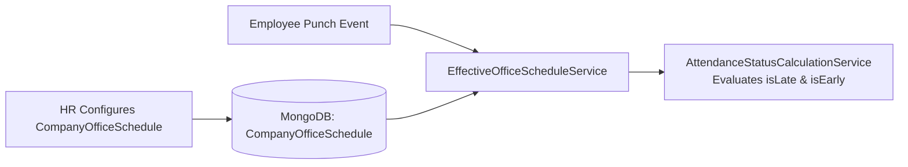

# WORK SHIFT & OFFICE SCHEDULE MODULE (`WORK-SHIFT.md`)

## 1. Module Overview
The **Work Shift & Office Schedule Module** defines standard and department/employee-specific working hours (`CompanyOfficeSchedule`), check-in grace periods (`GraceMinutes`), earliest check-out thresholds (`CheckOutAllowedFrom`), and half-day duration requirements (`HalfDayThresholdHours`). It is resolved dynamically by `EffectiveOfficeScheduleService` for every daily attendance evaluation.

---

## 2. Real-World Business Scenario
1. **Company Schedule Setup**: HR Admin configures the default company office schedule via `OfficeScheduleSettingsService`: `StartTime = "09:30"`, `EndTime = "18:30"`, `GraceMinutes = 15` (`CheckInAllowedUntil = "09:45"`), `CheckOutAllowedFrom = "18:15"`, `FullDayHours = 8.0`, and `HalfDayThresholdHours = 4.0`.
2. **Effective Schedule Resolution**: When Rahul Sharma punches in on `2026-04-14`, `EffectiveOfficeScheduleService` resolves the effective schedule for Rahul's `(CompanyId, DepartmentId, Date)` and supplies the exact cutoff timestamps to `AttendanceStatusCalculationService`.

---

## 3. Actors
| Actor | Capabilities |
|---|---|
| **HR Admin / Company Admin** | Configures `CompanyOfficeSchedule` timings, grace minutes, and half-day hour thresholds. |
| **Employee** | Views assigned shift timings on the attendance and calendar dashboard. |

---

## 4. Frontend Implementation
| File | Responsibility | Calls | Used By |
|---|---|---|---|
| `src/app/modules/settings/pages/OfficeScheduleSettings.tsx` | Form for configuring `StartTime`, `EndTime`, `GraceMinutes`, `CheckInAllowedUntil`, `CheckOutAllowedFrom`, and `HalfDayThresholdHours`. | `GET /api/office-schedule`, `PUT /api/office-schedule` | HR Admin |
| `src/app/modules/attendance/pages/AttendancePage.tsx` | Displays expected shift start/end times and grace window next to daily check-in button. | `GET /api/office-schedule/effective` | Employee |

---

## 5. Backend Implementation
| Backend File | Responsibility | Dependencies |
|---|---|---|
| `Controllers/OfficeScheduleController.cs` | CRUD and effective resolution endpoints for `CompanyOfficeSchedule`. | `IOfficeScheduleSettingsService`, `IEffectiveOfficeScheduleService` |
| `Services/OfficeScheduleSettingsService.cs` | Validates and persists `CompanyOfficeSchedule` records per tenant. | `IMongoRepository<CompanyOfficeSchedule>` |
| `Services/EffectiveOfficeScheduleService.cs` | Resolves the active schedule for a specific employee and date, adjusting for half-day leaves/WFH. | `IMongoRepository<CompanyOfficeSchedule>` |

---

## 6. API Documentation
| Method | URL | Purpose | Auth / Permission | Request / Response | Side Effects |
|---|---|---|---|---|---|
| `GET` | `/api/office-schedule` | Retrieves current company office schedule settings. | JWT (`settings:read`) | `CompanyOfficeScheduleDto` | None |
| `PUT` | `/api/office-schedule` | Updates shift start/end times, grace window, and minimum hours. | JWT (`settings:update`) | `UpdateOfficeScheduleDto` | Updates `CompanyOfficeSchedule` |
| `GET` | `/api/office-schedule/effective` | Returns effective schedule for an employee on a target date. | JWT (`attendance:read`) | `EffectiveScheduleDto` | None |

---

## 7. Database Model
### `CompanyOfficeSchedule` (`CMS-Backend-Core/Codeji.CMS.Repository/Entities/CompanyOfficeSchedule.cs`)
- `Id` (`string`, PK)
- `CompanyId` (`string`, FK)
- `StartTime` (`TimeSpan` / `string`, e.g., `"09:30"`)
- `EndTime` (`TimeSpan` / `string`, e.g., `"18:30"`)
- `GraceMinutes` (`int`, e.g., `15`)
- `CheckInAllowedUntil` (`string`, e.g., `"09:45"`)
- `CheckOutAllowedFrom` (`string`, e.g., `"18:15"`)
- `FullDayHours` (`double`, default `8.0`)
- `HalfDayThresholdHours` (`double`, default `4.0`)
- `IsActive` (`bool`)

---

## 8. Business Rules
- **Validation Rule**: `EndTime` must be strictly after `StartTime`, and `HalfDayThresholdHours` must be `< FullDayHours`.
- **Grace Calculation Rule**: `CheckInAllowedUntil` equals `StartTime + GraceMinutes`. Any check-in after `CheckInAllowedUntil` triggers `isLate = true` in `AttendanceStatusCalculationService`.

---

## 9. Complete Workflow

---

## 10. State Machine
`CompanyOfficeSchedule` operates as an active configuration singleton/versioned rule per company (`Active` $\leftrightarrow$ `Superseded`).

---

## 11. Permissions
- `settings:read` / `settings:update` — View and modify `CompanyOfficeSchedule`.

---

## 12. Dependencies
- **Upstream**: `COMPANY-SETTINGS`.
- **Downstream**: `ATTENDANCE` (`AttendanceStatusCalculationService`), `WFH` (half-day window alignment).

---

## 13. Cross-Module Events
- Schedule updates immediately apply to subsequent `AttendanceStatusCalculationService` evaluations for unlocked attendance months.

---

## 14. Failure Scenarios
- **Missing Tenant Schedule**: `EffectiveOfficeScheduleService` falls back to safe default office hours (`09:30–18:30`, `15m` grace) so daily punches never crash.

---

## 15. Edge Cases
- **Night Shifts Crossing Midnight**: Current `StartTime`/`EndTime` comparisons assume same-calendar-day shifts (`StartTime < EndTime`).

---

## 16. Current Strengths
- Clean decoupling between schedule resolution (`EffectiveOfficeScheduleService`) and status computation (`AttendanceStatusCalculationService`).

---

## 17. Current Gaps
- Multi-shift rotation rosters (e.g., Morning/Evening/Night rotating weekly per employee) are not yet modeled as separate roster assignments.

---

## 18. Recommended Improvements
- Support multi-shift templates with employee-date roster assignment (`EmployeeShiftRoster`).

---

## 19. Future Scope
- Cross-midnight shift support and automated overtime calculation beyond `FullDayHours`.
